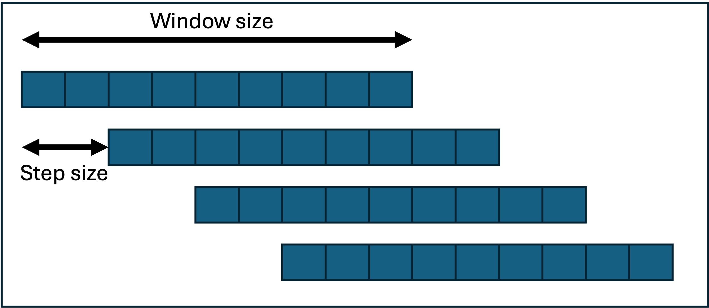

## Population structure

One of the core tenets of population genetics is to understand how population genetic structure changes temporally and spatially.

To assess the genomic structure of populations we can use many different metrics including PCA, FST and a whole suite of genetic diversity metrics you may remember from Genetics class.

Usually the first thing you will do with your VCF to assess population structure and identify any potential outliers is to visualise your data using a principal component analyses (PCA) that essentially summmarises all the variation of an indviduals genomics data into one point from *n* number of dimensions. The first axis of the PCA (or first component) explains the most variation, then PC2 explains the second most etc. In our context, the PCA summarises the variation in allele frequencies across the genome along the PCA axis.

First we will often LD thin our data before visualsing, as highly linked loci can distort the pattern as the PCA assumes that the data is independent and there are no correlations between the variables. Allele frequencies therefore can be highly correlated if linkage is high.

We can prune the LD using plink as well as generating the PCA downstream.

**Fun fact!** Plink suprisingly isnt a forced bacroynym like many of the software we used, rather it is a reference to linkage analysis where the p is refering to population genetics

An important caveat with plink is that it is designed for human data so theres a few percularities that we will address to get round using it for non-model organisms.

### Linkage pruning

First lets assign our VCF to an object

```{bash}
VCF=~/EcolGenom2026/PopulationGenomics26/myvcf.vcf.gz
###Make sure this is your path!
echo $VCF
###check your object is now correct, you can double check with the cd command to make sure it takes you there! Dont forget the $ sign otherwise it treats it as plain text
cd $VCF
```

Now lets prune the data, check you are using plink version 1.9, as there were major changes for 2.0 onwards that will mean our code wont work with the new syntax

```{bash}
module load plink 
##check version
plink --version 

#perform LD thinning
plink --vcf $VCF --double-id --allow-extra-chr \
--set-missing-var-ids @:# \
--indep-pairwise 50 10 0.2 --out myvcf_Ld_0.2

```

Ok now lets run through what we actually asked plink to do (remember you can always use -h)

- `--vcf` = location of your VCF file
- `--double-id` = duplicate the id of our samples as plink usually expectds a family and individual for pedigree data which we do not have so they are essentially the same
- `--allow-extra-chr` = The default for plink is 1-22 and X as it is set up for human genetics, so we need to tell it to allow exta chromosomes beyond this.
- `--set-missing-var-ids` = Human and some model organisms have annotated SNP names, we do not so we set ours to default names being chr:pos (e.g., Chr1:189290) achieved by the \@:# option
- `--indep-pairwise` = This is where we actually do the pruning! First we say set a window of 50 kb, with a 10 window step size, and a r2 threshold of 0.1 (filter out any variables that show an r2 \> 0.1)
- `--out` designated prefix for output data

**How does a sliding window analysis work?**

Here is an example where step = 2 and window = 10. The statistic is generated in each window as it slides across the genome, whilst the step size indicates how far along to move before repeating the analysis.



**What is r2?**

r2 is a measure of how strongly two genetics variants on a chromsome are correlated with eachother as a measure of linkage disequilibirum from a scale of 0 -\> 1 where 0 is complete independence whilst 1 are completely linked.

*Exercises* - A good way to understand code is sometimes to break it, what happens when you forget to add --allow-extra-chr, what is the warning? - Why do you think we use sliding window analyses? - What are the other options you could add for LD pruning? - What output files do you now have?

### PCA

```{bash}
plink --vcf $VCF --double-id --allow-extra-chr --set-missing-var-ids @:# \
--extract myvcf_Ld_0.2.in \
--make-bed --pca --out myvcf_Ld_0.2

```

Now to generate our PCA we adjusted the plink command as follows:

- `--extract` = this is what data we want to use from the VCF, in this case only those data that have a LD less than 0.2
- `--make-bed` = this makes a bed file for us which has genotypes stored as 1s and 0s as in the VCF.
- `--pca` = tells plink to generate pca

This command will produce the following:

- `myvcf_Ld_0.2.eigeneval` = eigenvalues from pca
- `myvcf_Ld_0.2.eigenvec` = eigenvectors from pca
- `myvcf_Ld_0.2.bed` = bed file
- `myvcf_Ld_0.2.bim` = map file of variants contained in the bed file, like our index's
- `myvcf_Ld_0.2.fam` = map files of individuals within the bed

**Eigenvectors** = the directional axes (the principal components) of the PCA

**Eigenvalues** = the magnitude of variance across each of these axes

### Plotting the PCA

**Now back to R**

First set library's we will use, lets keep it simple with just tidyverse

```{R}
library(tidyverse)
```

Now lets read the pca data generated from plink

```{R}
###read table excluding column names
pca <- read_table("myvcf_Ld_0.2.eigenvec", col_names = FALSE)
###scan reads data from a list (this is not a dataframe)
eigenval <- scan("myvcf_Ld_0.2.eigenval")

##we dont need two sets of sample columns (generated from family)
##remember [row, col] 
pca <- pca[,-2]

###assign column ID names [1] changes first instance of names, if you run just names(pca) you will see list of current column names X1, X2 etc 
names(pca)[1] <- "Population"
### this function says rename column 2 - number of columbs that there are ncol function
###it then add the term PC1 = number of columns so its PC1, PC2 etc. 
###paste0 function concatenates the PC string and the nymeric value into the new name
names(pca)[2:ncol(pca)] <- paste0("PC", 1:(ncol(pca)-1))
```

Lets first look at the variance across the PC, this helps us determine how many PCs we might consider looking at contributing towards the variation. Note in genomics variation contributed is often small due to all the neutral variation across the genome.

```{R}
#### we need to change the eogenvalues to a dataframe and convert to a % 
pve <- data.frame(PC = 1:10, pve = eigenval/sum(eigenval)*100)
###we can do a very simple ggplot where we use the geom bar function to generate a barplot across the PC components
##stat = indentit 
a <- ggplot(pve, aes(PC, pve)) + geom_bar(stat = "identity")
a + ylab("Percentage variance explained") 
ggsave(a, file = "variance_0.2.png")

```


Now lets plot the PCA itself:


## Admixture

```{bash}
 
module load admixture
 
INPUT="/gpfs2/scratch/dsadler1/SeaUrchinEnvPop/AllProjects/UrchinVCF/admixture/urchin_admixture_input.bed"
WORKDIR="admixture_tutorial"  
K_MIN=1
K_MAX=10
THREADS=4                      

cd "${WORKDIR}" 
 
for K in $(seq ${K_MIN} ${K_MAX}); do
    admixture --cv -j${THREADS} "${INPUT}" ${K} | tee "admixture_K${K}.out"
    CV=$(grep "CV error" "admixture_K${K}.out" | awk '{print $NF}')
    echo -e "${K}\t${CV}" >> cv_errors.tsv
done

```

Here we are using another for loop to run the admixture model. 

`K` within the sequence from 1-10 (modelling 1-10 populations) 

`--cv`


